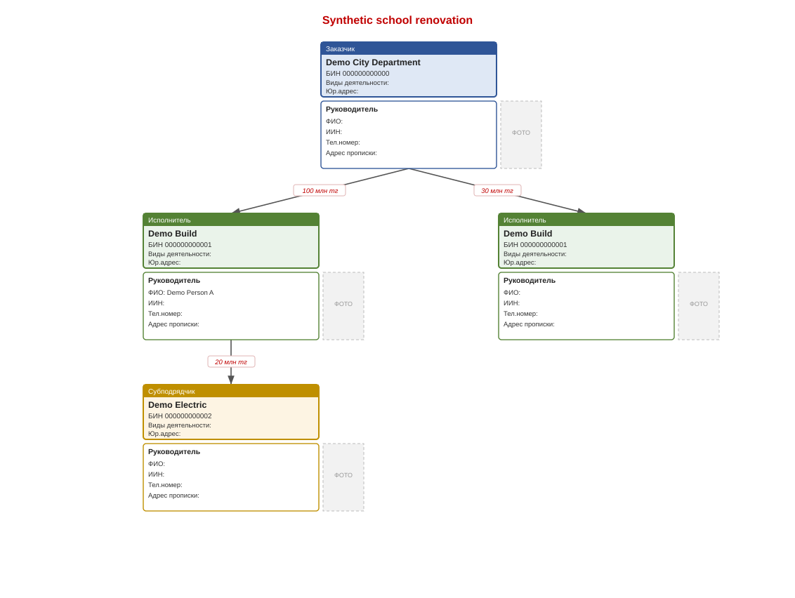

# Document Intelligence Toolkit — Public Demo

Convert Word reports and Excel relationship diagrams into structured organization
trees, editable graphs and generated documents. Python performs parsing and
rendering; an optional Qwen model running through Ollama assists extraction and
wording.

Public portfolio example using synthetic organization and contract data.

## What it demonstrates

- Word (.docx) to JSON, Excel drawing shapes, SVG and a standalone HTML editor.
- Excel drawing shapes and connectors to a Word report and structured data.
- Russian and Kazakh extraction examples, including nested subcontractors.
- Separate contracts and parent relationships for repeated organizations.
- Schema checks, conservative checks of extracted names/amounts against source text,
  deterministic fallback, and bounded graph traversal.
- Synthetic regression cases that run without a model or external services.

## Try the synthetic demo

Python 3.11–3.13 is covered by CI. Get the public example:

```bash
git clone https://github.com/55AIAI/document-intelligence-toolkit.git
cd document-intelligence-toolkit
```

Then run:

```bash
python -m venv .venv
# Activate: .venv\Scripts\Activate.ps1 (PowerShell), or source .venv/bin/activate
python -m pip install -r requirements.txt
python main.py demo/sample.json --no-llm
```

Open `demo/sample_editor.html` in a browser. The same command produces
`demo/sample_scheme.xlsx` and `demo/sample_graph.svg`. All demo organizations, identifiers
and people are fictitious. Demo Build deliberately appears twice with different
contracts; both occurrences must survive conversion.



## Convert a document

```bash
python main.py report.docx --no-llm --graph --html
python main.py diagram.xlsx --no-llm
python main.py report.docx --no-llm --anonymize --graph --html
python main.py --help
```

Outputs are written next to the input. Excel input must contain drawing shapes
and connectors; arbitrary spreadsheets are not supported. PDF/OCR is not included.

## Optional local LLM

Install Ollama separately and run `ollama pull qwen2.5`. The default model is
`qwen2.5` at `http://localhost:11434`. Override OLLAMA_MODEL
and OLLAMA_URL using environment variables. A .env.example is supplied
as a reference; the CLI does not automatically load .env files.

An unavailable model or invalid extraction falls back to rules. Inputs longer
than the extraction context limit use the complete text in the deterministic
parser instead of silently truncating it. A remote OLLAMA_URL sends text to
that configured server; use the default loopback address for local processing.

## Checks

```bash
python -m unittest discover -s tests -v
```

Tests cover six synthetic Word layouts, distinct contracts, shared subcontractors,
cyclic graphs, malformed structures, rejected LLM facts, anonymization and output
OpenXML structure. If Node.js is installed, the editor JavaScript is syntax
checked and cycle handling is executed too. CI installs Node for that check.
No real Ollama integration or Office visual compatibility is claimed by unit tests.

Read [architecture](docs/architecture.md) and [limitations](docs/limitations.md).
